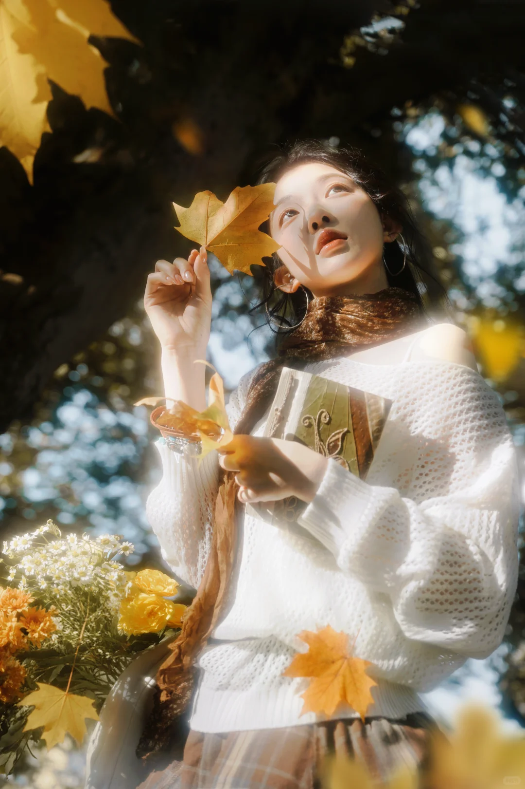
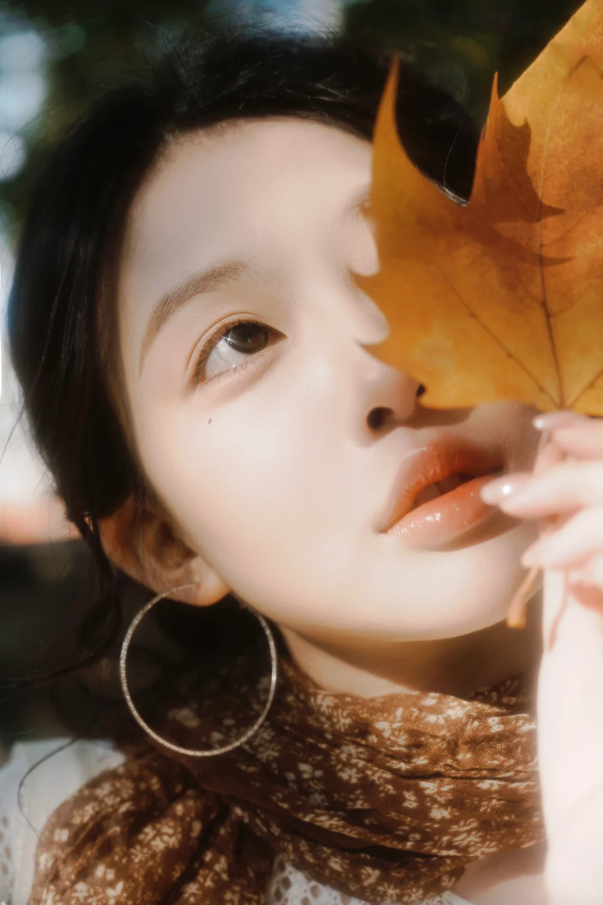
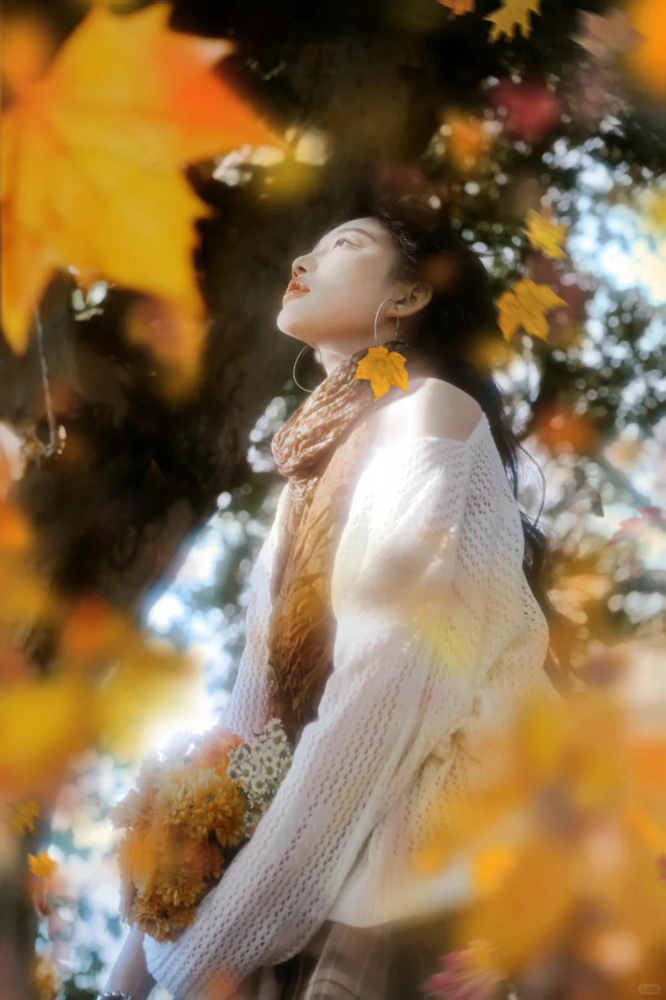
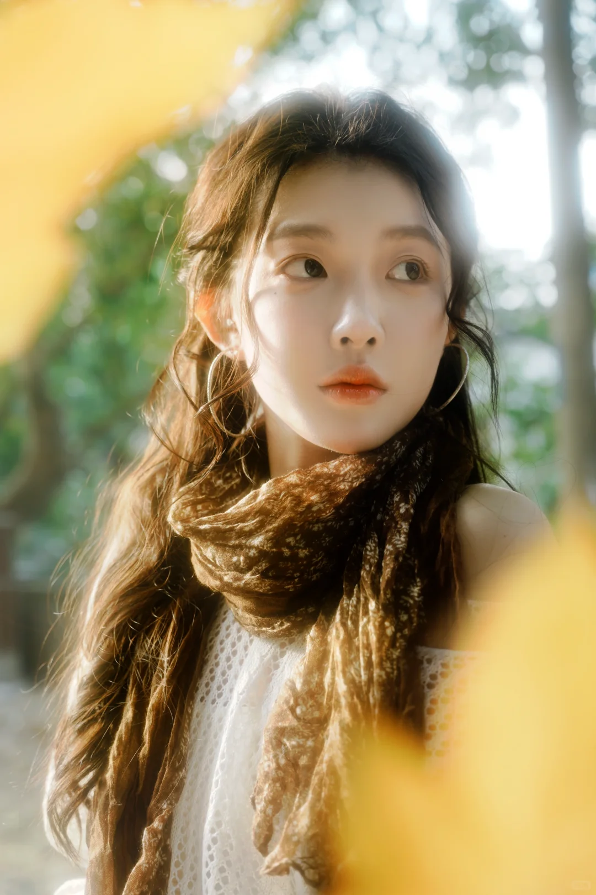
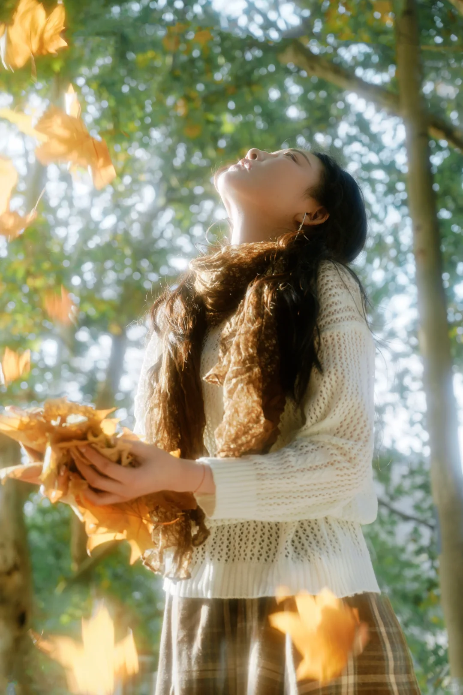
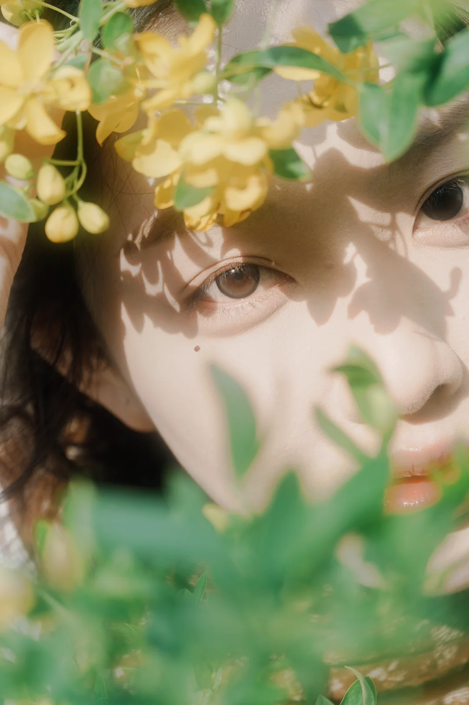
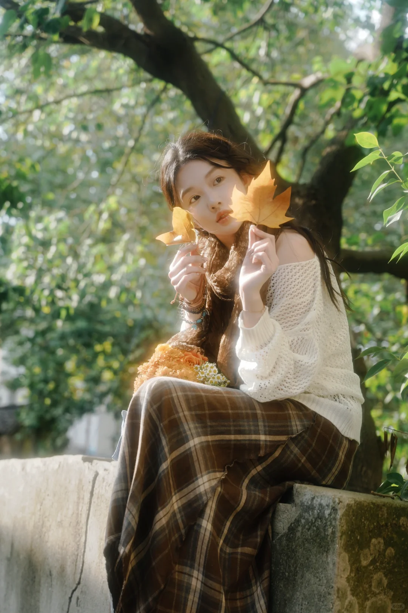

# 秋日人像摄影策划

主题：秋日林间的温柔感与微醺感  
整体风格：金黄色、朦胧、自然、轻复古。以树叶前景、斑驳光影、低机位和逆光制造包裹感。  
色彩关键词：奶油白、焦糖棕、枫叶黄、深绿。

## 一、样片盘点与补拍优先级

| 参考画面 | 主景别 | 画面作用 | 可借鉴要点 |
|---|---|---|---|
|  | 中景 | 展示人物、服装与花束关系 | 低机位、仰拍、逆光、叶片遮挡 |
|  | 特写 | 强化面部情绪与秋叶互动 | 叶片贴近脸部，眼神向上，柔和高光 |
|  | 近景 | 表现人物侧脸和秋日氛围 | 前景虚化，人物置于树叶之间 |
|  | 近景 | 传达安静、温柔的肖像情绪 | 叶片框景，侧逆光，浅景深感 |
|  | 中景 | 表现捧叶动作和身体姿态 | 抬头、双手抱叶、逆光轮廓 |
|  | 特写 | 表现眼睛、花朵和光影细节 | 花叶遮脸，局部阴影投射 |
|  | 全景 | 展示完整造型与环境关系 | 坐姿、树干、长裙和花束构成完整画面 |

### 景别汇总

| 景别 | 数量 | 已覆盖 | 缺口 |
|---|---:|---|---|
| 远景 | 0 | 暂无环境建立镜头 | 极度缺少 |
| 全景 | 1 | 完整人物姿态、服装关系 | 增加站立或行走的完整造型 |
| 中景 | 2 | 道具互动、身体语言 | 基本覆盖 |
| 近景 | 2 | 情绪肖像、侧脸氛围 | 基本覆盖 |
| 特写 | 2 | 五官、叶片、花朵细节 | 基本覆盖 |
| 空镜 | 0 | 暂无 | 需要补拍连接镜头 |

### 补拍优先级

1. **远景｜最高优先级**：人物在林荫、落叶路或树阵中的小比例画面，交代“人在秋天里”的环境叙事。
2. **全景｜第二优先级**：增加站立或行走的完整造型，让针织衫、围巾和格纹裙形成完整视觉记忆。
3. **空镜｜第三优先级**：拍摄树叶、树干、花束、地面落叶和光斑，用于组图开头、转场或结尾。

## 二、地点

暂按“城市公园或植物园内的林荫区域”规划，优先寻找高大树木、低垂枝叶、落叶路、石阶或长椅，以及能保留深绿色与金黄色的背景。建议路线：林间小路 → 树下空地 → 石墙/长椅 → 花木或落叶区域。

## 三、时间

- 晴天上午适合清透、轻盈的画面；下午适合焦糖色、棕色和金黄色氛围。
- 提前到场观察树影，先拍远景、全景和中景，光线变柔后拍近景与特写。
- 具体日期、当地落叶状态和场地预约：待确认。

## 四、妆造

### 服装建议

奶油白或米白色宽松针织衫、焦糖棕围巾、棕色格纹半身长裙、复古皮鞋或棕色短靴；可备一件深棕色外套。避免大面积纯黑、荧光色和复杂印花。

### 妆容建议

轻薄透亮底妆，米棕或浅金眼妆，杏橘/枫叶棕唇色，暖色腮红；避免过重修容。

### 发型建议

自然长发或低马尾，耳侧保留少量碎发，让发丝被逆光勾勒，但不要遮住双眼。

## 五、道具

枫叶或梧桐叶用于遮脸、贴近眼睛或夹在耳侧；橙色、奶油白、焦糖色花束用于中景和全景；棕色围巾用于制造层次；少量落叶可由助手在镜头前轻轻抛洒；透明玻璃瓶或小花篮作为备选道具。

## 六、景别缺口与补拍建议

以下内容不是用户提供的样片，只是针对缺少景别的拍摄建议。

### 远景｜补拍建议｜待配参考图

**画面任务：** 交代人物与林间、落叶路和树阵的空间关系。  
**建议机位：** 摄影师站在林间小路较远处，机位略低于人物视线，竖构图；人物占画面约三分之一。  
**建议光位：** 人物面朝较亮的一侧，太阳位于侧后方；光线过硬时向树荫内退半步。  
**动作/环境安排：** 人物沿小路缓慢行走，手持花束，偶尔回头或抬头看树叶。

### 空镜｜补拍建议｜待配参考图

**画面任务：** 为组图提供开场、转场和收尾画面。  
**建议机位：** 低机位拍树冠与天空，或贴近地面拍落叶、鞋尖和花束；横竖构图各拍一组。  
**建议光位：** 选择阳光穿过树叶形成光斑的位置，拍叶片透光、花束边缘光和地面阴影。  
**动作/环境安排：** 拍摄树叶晃动、围巾一角、手指捡起落叶、花束放在石墙上。

## 七、样片镜头方案

### 全景｜必拍

**机位：** 摄影师蹲低或坐低拍摄，竖构图，完整保留头部、上身、裙摆和坐姿。  
**光位：** 人物位于树荫边缘，光线从侧后方进入，树叶和头发形成轻微轮廓光。  
**描述：** 人物坐在石墙或长椅上，双手举叶子靠近脸侧，身体微微前倾，展示完整造型。

### 中景｜必拍

**机位：** 低机位仰拍，取人物腰部以上；前景放一两片离镜头较近的叶子。  
**光位：** 人物面朝树隙亮处，太阳从侧后方进入；面部过亮时转向侧面约三十度。  
**描述：** 一只手举叶子贴近眼睛，另一只手托住花束或围巾，视线向上。

### 中景｜必拍

**机位：** 摄影师站在人物斜前方，机位略低，取头部至大腿；人物放在画面右侧。  
**光位：** 光从侧后方穿过头发和围巾，面部朝向较亮的反光区域。  
**描述：** 人物双手捧起一小把落叶，抬头闭眼或轻轻呼吸，突出被秋天包围的感觉。

### 近景｜必拍

**机位：** 摄影师与人物平视，取肩部至胸口，竖构图；前景用虚化叶片框景。  
**光位：** 光从左侧斜后方进入，人物脸部朝向较柔的一侧。  
**描述：** 人物直视镜头，表情安静，围巾占据画面下方，背景保留绿色树影和光斑。

### 近景｜必拍

**机位：** 摄影师站在人物侧前方，略低机位，取肩部至腰部；用近处叶片遮挡画面四周。  
**光位：** 人物面朝树冠亮处，太阳位于侧后方，让脸部处于光影交界。  
**描述：** 人物侧脸抬头，手指轻触围巾或耳环，另一只手拿花束。

### 特写｜必拍

**机位：** 平视或略高于人物眼睛，取脸部和一只手，重点保留眼睛、鼻梁和嘴唇。  
**光位：** 光从正侧方或侧后方进入，人物微微转脸，让叶片投下局部阴影。  
**描述：** 人物捏住叶片边缘，叶片贴近嘴唇或鼻尖，眼神看向远处，保持若有所思。

### 特写｜必拍

**机位：** 靠近人物，取双眼、鼻梁和嘴部局部；前景放少量花叶，形成半遮挡。  
**光位：** 让树叶缝隙光落在脸部，优先保留眼睛清晰的瞬间。  
**描述：** 人物从花叶后看向镜头，重点拍摄眼睛反光、叶片纹理和脸部光影。

## 执行重点

先完成远景和全景，再拍中景动作，最后拍近景与特写。前景叶片要有虚实变化，不要每张都遮挡同一位置；保持白色针织衫干净明亮，让棕色围巾和格纹裙承担秋日色彩。
